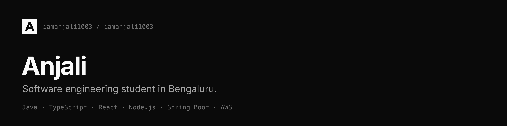

Final-year Information Science student at JSS Academy of Technical Education, Bengaluru, graduating in 2027. I build full-stack apps with React, Node.js and Spring Boot, and I contribute to Kubernetes.

[Portfolio](https://iamanjali1003.github.io) · [Blog](https://iamanjali1003.github.io/blog/) · [LinkedIn](https://linkedin.com/in/iamanjali1003) · [Email](mailto:iamanjali1003@gmail.com)

## Open source

- **Kubernetes · [inference-perf](https://github.com/kubernetes-sigs/inference-perf)**: fixed benchmark reports that overstated the achieved request rate in every run ([#1055](https://github.com/kubernetes-sigs/inference-perf/pull/1055), [#1071](https://github.com/kubernetes-sigs/inference-perf/pull/1071)). [How I found it](https://iamanjali1003.github.io/blog/fence-posts-and-gaps/)
- **Kubernetes · [Headlamp](https://github.com/kubernetes-sigs/headlamp)**: show suspended CronJobs and Jobs as suspended, not degraded ([#8486](https://github.com/kubernetes-sigs/headlamp/pull/8486))
- **Hacktoberfest**: completed [2024](https://drive.google.com/file/d/1llP7FIIgWXAP9vZ8Gf6RpLwLQ3OJ6Abw/view) and [2025](https://drive.google.com/file/d/1Zkq-ao_LBuOOWMgntiWhTtKd3YttMJng/view), including [parquet-go #177](https://github.com/parquet-go/parquet-go/pull/177) and [stock-backend #13](https://github.com/shivamsouravjha/stock-backend/pull/13)

## Projects

| Project | What it is | Stack |
| --- | --- | --- |
| [pixStory](https://github.com/iamanjali1003/pixstory) | Photo gallery with presigned uploads straight to S3, CloudFront delivery and JWT auth | React, TypeScript, Node.js, MongoDB, AWS |
| [datacheck](https://github.com/iamanjali1003/datacheck) | CLI that validates CSV files against YAML rules, with rules and report formats loaded as plugins | Java 21, JUnit 5, GitHub Actions |
| [monoCV](https://github.com/iamanjali1003/monocv) | ATS-friendly resume builder with live preview and PDF export | Next.js, TypeScript, Zustand, Zod |
| [Midas](https://github.com/iamanjali1003/forage-midas) | Spring Boot service that processes transactions from Kafka and tracks balances | Java, Spring Boot, Kafka, JPA |

## Also

- **Stack:** Java · TypeScript · Python · SQL · React · Next.js · Node.js · Spring Boot · Kafka · MongoDB · PostgreSQL · AWS · Docker
- **Competitive programming:** CodeChef 3★, max rating 1674, global rank 90 in Starters 197 · [CodeChef](https://www.codechef.com/users/iamanjali1003) · [LeetCode](https://leetcode.com/u/iamanjali1003)
- **Before:** Software QA Intern at Evaratus (Scaler AI Labs), Sep to Nov 2026
- Open to software engineering internships and new-grad roles
